# AI Agent Mini-Project — 운영 인시던트 대응 에이전트

> "payments-service 결제 응답이 느려지고 CPU가 치솟았어요" 같은 운영 문의를 받으면, 모니터링 수치와
> 최근 로그를 직접 조회하고 대응 매뉴얼(runbook)을 찾아 **근거 기반 진단 보고**를 돌려주는 에이전트입니다.
> LangGraph 그래프 + MCP 서버 + RAG + Human-in-the-loop 승인으로 구성돼 있고, 모든 요청은 LangSmith에
> 계층 트리로 기록됩니다.

- 저장소: https://github.com/boboinhaco/AI-Agent-Mini-Project
- 과제 유형: **1번 — Base AI Agent 기능 개선/추가** (SK AX AI 서비스 개발 Mini-project)
- 상세 매뉴얼: [doc/README.md](doc/README.md) · [doc/manual_ollma.md](doc/manual_ollma.md) · [doc/manual_openai.md](doc/manual_openai.md)
- Before 기록: [before/README.md](before/README.md) · After 기록: [after/README.md](after/README.md)

---

## 목차

1. [이 에이전트가 하는 일](#1-이-에이전트가-하는-일)
2. [아키텍처](#2-아키텍처)
3. [빠른 시작](#3-빠른-시작)
4. [Before — 개선 전 상태와 증거](#4-before--개선-전-상태와-증거)
5. [무엇을 바꿨나 (수정/개선 + 추가)](#5-무엇을-바꿨나-수정개선--추가)
6. [After — 달라진 점과 증거](#6-after--달라진-점과-증거)
7. [프로젝트 구조](#7-프로젝트-구조)
8. [측정 방법 (재현)](#8-측정-방법-재현)
9. [한계와 트레이드오프](#9-한계와-트레이드오프)
10. [남은 과제 처리 (3차)](#10-남은-과제-처리-3차)
11. [기술 스택](#11-기술-스택)

---

## 1. 이 에이전트가 하는 일

| 입력 | 에이전트가 하는 일 | 출력 |
|---|---|---|
| "auth-service 로그인 응답이 느려요" | ① 장애 문의인지 판별 → ② MCP Prompt로 표준 진단 절차를 받아 할 일 계획 → ③ **메트릭·로그·런북 서브에이전트**가 병렬 조사 → ④ 부족하면 **RAG**로 맞는 runbook을 찾아 재조사 → ⑤ 보고서 초안 작성 → ⑥ 재시작·롤백 같은 **위험 조치는 운영자 승인** → ⑦ 코드 검증(수치 인용·없는 시스템 금지) | `1) 모니터링: auth-service degraded, CPU 81.8%, 커넥션 풀 92% 2) 절차: … 3) …` |
| "안녕, 너는 누구야?" / "제 이름이 뭐였죠?" | 무거운 파이프라인을 건너뛰고 세션 이력(요약 메모리 포함)으로 바로 답변 | 짧은 대화 응답 |

LLM 자리는 `fake`(결정론 스텁) / `ollama`(로컬 qwen3) / `openai`(gpt-4o) 중 환경변수 하나로 바꿔 끼울 수 있고,
그래프·MCP·세션 코드는 그대로입니다.

## 2. 아키텍처

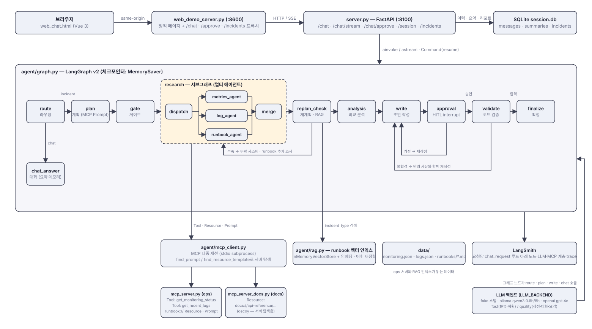

- 위쪽 행은 요청 경로(브라우저 → 프록시 → FastAPI → SQLite), 가운데 큰 상자는 LangGraph 파이프라인, 아래 행은 그래프가 호출하는 외부 구성요소(MCP 서버들, RAG 인덱스, 데이터, LangSmith, LLM 백엔드)입니다.
- 점선 상자 `research`는 compiled subgraph로, metrics·log·runbook 에이전트 셋이 같은 단계에서 병렬로 돌고 merge가 정리합니다.
- 아래로 꺾여 돌아가는 선 세 개가 자기 교정 루프입니다: replan_check → research(누락 시스템·runbook 보충), approval → write(운영자 거절), validate → write(검증 불합격).

핵심 설계 원칙은 "모델의 판단을 그대로 믿지 않고, 코드로 검증 가능한 결정은 코드가 내린다"입니다.
gate(불필요 task 제거), replan(누락 보완), validate(수치 인용 검사), approval(사람 승인)이 그 방어선입니다.

## 3. 빠른 시작

```bash
# 0) 최초 1회 — 가상환경 + 의존성
bash sh/setup_venv.sh
cp .env.example .env          # LangSmith / OpenAI 키 입력 (.env는 커밋되지 않음)

# 1) 로컬 실모델 (무료) — qwen3:0.6b / qwen3:8b + 임베딩 nomic-embed-text
bash sh/setup_ollama.sh
ollama pull nomic-embed-text
bash sh/run_agent_ollma.sh    # 백엔드 :8100

# 2) 브라우저 채팅 (새 터미널)
bash sh/run_frontend.sh       # http://localhost:8600

# (대안) 결정론 스텁으로 빠르게 확인
LLM_BACKEND=fake .venv/bin/uvicorn server:app --port 8100
```

curl로 바로 써보기:

```bash
curl -s -X POST localhost:8100/chat -H 'Content-Type: application/json' \
  -d '{"message":"cache-service 메모리 사용률이 계속 올라가고 있어요","thread_id":"t1"}' | python3 -m json.tool --no-ensure-ascii
# → status: "approval_required" 이면 (재시작 조치 포함) 승인:
curl -s -X POST localhost:8100/chat/approve -H 'Content-Type: application/json' \
  -d '{"thread_id":"t1","approved":true}'
```

| 환경변수 | 기본값 | 의미 |
|---|---|---|
| `LLM_BACKEND` | `fake` | `fake` / `ollama` / `openai` |
| `SUPERVISOR_VERSION` | `v2` | `v1`이면 라우팅·게이트·검증 없는 legacy 선형 파이프라인 |
| `HITL_APPROVAL` | `1` | `0`이면 승인 노드 비활성 |
| `OLLAMA_FAST_TIMEOUT` | `90` | 분류·계획용 소형 모델 호출 상한(초). 초과 시 코드 계획으로 복구 |
| `MEMORY_SUMMARY_THRESHOLD` / `MEMORY_KEEP_RECENT` | `10` / `4` | 요약 메모리 트리거 메시지 수 / 원문으로 남길 최근 메시지 수 |

## 4. Before — 개선 전 상태와 증거

코드를 손대기 전에 회귀 쿼리 10개([doc/regression_test_queries.md](doc/regression_test_queries.md))를
`POST /chat`에 보내 수치와 화면을 `before/`에 보관했습니다.

### 수치 (`before/summary_*.md`)

| 지표 | fake | ollama (qwen3:0.6b / 8b) |
|---|---|---|
| 정확도 체크 통과 | **7 / 32 (22%)** | **24 / 29 (83%)** |
| 서버 오류 | 0 | **2건** (q8 500, q9 연결 끊김) |
| 총 지연 | 1.3s | 292s (8건 완료 기준) |
| 검증 반려 | 1건 (길이 검사) | 0건 |

### 발견된 문제

| # | 문제 | 증거 |
|---|---|---|
| 1 | fake 라우터가 "느려요/타임아웃/메모리/디스크" 문의 **9건을 잡담(chat)으로 오분류** | `before/metrics_fake.csv` route 열, 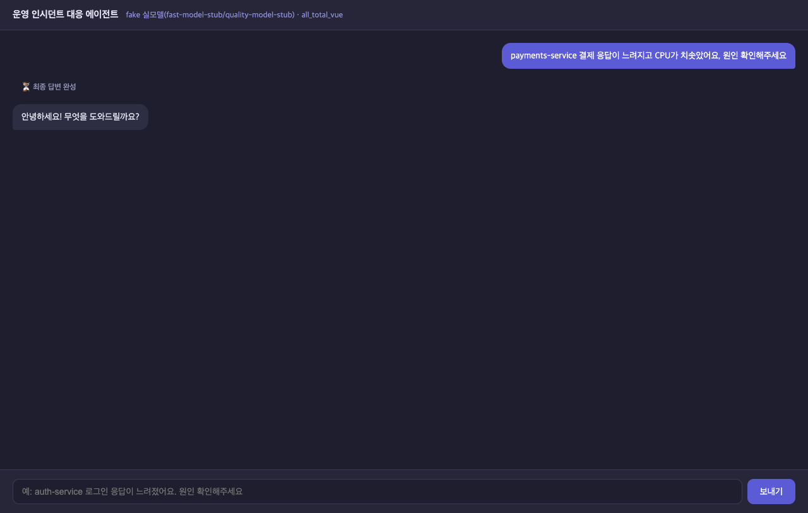 |
| 2 | web-01 CPU 급증인데 **`db-down` runbook**을 고름 (키워드 못 찾으면 기본값으로 폴백) | 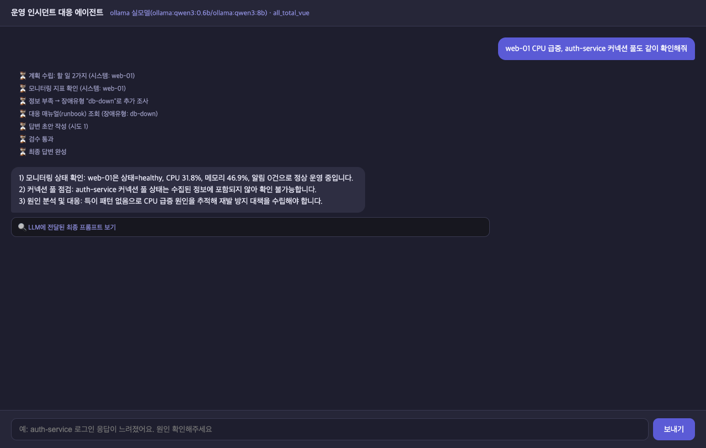 |
| 3 | 두 시스템을 언급하면 **첫 번째만 조사** (q4·q5·q6) | 위 화면: auth-service는 "확인 불가" |
| 4 | `billing-service 응답이 느려요` → plan 단계 소형 모델이 300초 무응답 → **HTTP 500** | `before/env/server_log_q8_billing.txt` (traceback) |
| 5 | LLM 호출이 **동기 `httpx.post`**라 4번이 진행되는 동안 서버 전체가 멈춤 → 다음 요청 연결 끊김 | 같은 로그, q9 `Connection reset by peer` |
| 6 | 검증이 "30자 이상 + `1)` 포함"만 검사 — 수치를 지어내도 통과 | `agent/graph.py`(before 스냅샷) `validate_node` |
| 7 | 338줄 `graph.py` 한 파일에 노드 10개, LLM 백엔드 2개에 같은 보정 코드 중복 | `before/env/line_counts.txt` |

개선 전 그래프 (가로 배치로 다시 그림, 원본은 `before/env/graph_v2.png`):

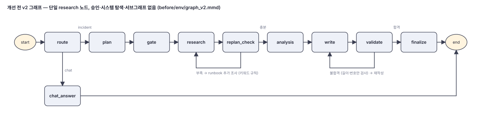

## 5. 무엇을 바꿨나 (수정/개선 + 추가)

### 수정/개선 — 커밋 `기본 기능 개선`

| 영역 | Before | After | 파일 |
|---|---|---|---|
| **모듈화** | graph.py 338줄에 노드 전부 | 노드별 파일 `agent/nodes/*.py`, 공용 상태 `agent/state.py`, graph.py는 엣지 조립만 | `agent/nodes/`, `agent/state.py`, `agent/graph.py` |
| **RAG 분류** | 키워드 9줄 규칙 + db-down 폴백 | runbook 6개를 벡터 인덱스(InMemoryVectorStore)에 넣고 "질문 + 저하 시스템 알림"으로 의미 검색. runbook에 증상 섹션 추가. 임베딩: fake=문자 n-gram 해싱, ollama=nomic-embed-text, openai=text-embedding-3-small | `agent/rag.py`, `agent/nodes/replan.py`, `data/runbooks/*.md` |
| **라우팅** | 키워드 7개 | 확장 장애 표현 + 알려진 시스템명 언급 시 incident로 코드 교정 | `agent/state.py`, `agent/nodes/route.py` |
| **검증 강화** | 길이 + `1)` | ① 조사한 시스템 전부 언급 ② CPU/메모리 수치 인용 ③ 조사·질문에 없는 시스템명 금지. 반려 사유를 write에 피드백 | `agent/nodes/validate.py` |
| **안정성** | 동기 호출, 300초 대기 후 500 | 비동기 호출, 소형 모델 90초 타임아웃 시 코드 레벨 계획으로 복구 | `agent/ollama_llm.py`, `agent/openai_llm.py` |

### 추가 — 커밋 `기능 추가`

| 기능 | 내용 | 파일 |
|---|---|---|
| **Research 서브그래프 (멀티 에이전트)** | 단일 research_node → `dispatch → (metrics_agent ∥ log_agent ∥ runbook_agent) → merge` compiled subgraph. 세 에이전트가 같은 superstep에서 동시에 돌고 `Annotated[list, add]` 채널에 결과만 추가. log_agent용 MCP Tool `get_recent_logs` + `data/logs.json` 신설 | `agent/subgraphs/research.py`, `mcp_server.py` |
| **Human-in-the-loop 승인** | `write → approval → validate`. 재시작·롤백·failover·스케일 아웃·LB 제외·볼륨 확장·삭제가 초안에 있으면 `interrupt()`로 멈춤. 승인 → 검수, 거절 → 사유를 피드백으로 재작성, 2회 거절 후 "실행 금지" 경고를 달아 종료. `/chat/approve`, `/chat/approve/stream`, Vue 승인 카드 | `agent/nodes/approval.py`, `server.py`, `web_chat.html` |
| **대화 요약 메모리** | 미요약 메시지 10개 초과 시 최근 4개만 원문, 나머지는 품질 모델이 `사용자 이름 / 주요 사실 / 진행 중인 요청` 형식으로 요약 → `summaries` 테이블. `/session/{thread_id}`로 크기 확인 | `agent/memory.py`, `agent/session_store.py` |

개선 후 그래프 (서브그래프 · RAG 재계획 · HITL 승인 · 코드 검증):

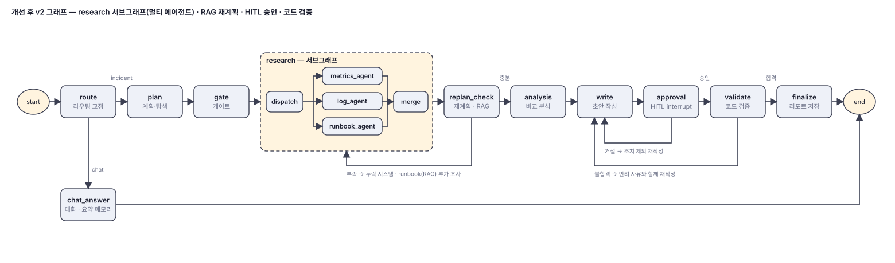

## 6. After — 달라진 점과 증거

### 수치 (같은 쿼리 10개, `after/summary_*.md`)

| 지표 | Before | After 3차 | **After 5차 (검토 반영, 현재 코드)** |
|---|---|---|---|
| ollama 정확도 체크 | 24 / 29 (83%) | 32 / 32 | **34 / 34** (5차부터 조사 시스템을 '선별된 근거' 기준 정확 일치로 더 엄격히 채점) |
| ollama 서버 오류 | 2건 | 0건 | **0건** (오류는 화면에 `Error` 이벤트로 전달) |
| ollama 총 지연 | 294s (8건 완료 기준) | 657s | 791s (대화도 8b 모델, 5항목 답변 틀) |
| ollama 검증 반려→재작성 | 0건 (검사가 길이뿐) | 4건 | 5건 |
| HITL 승인 요청 | — | 6회 (쿼리당 최대 2회) | **4회** (질문당 1회) |
| 과잉 조사(기대 밖 시스템) | 측정 안 함 | 측정 안 함 | **0** |
| LLM-as-judge (3점 × 8건) | — | 21 / 24 | **24 / 24** |
| RAG 단독 분류 (8케이스) | 키워드 규칙 5/8 수준 | 8 / 8 | 8 / 8 |
| fake 정확도 (회귀 검출용) | 7 / 32 | 32 / 32 | 34 / 34 |
| 단위 테스트 | 없음 | 32개 | **49개 통과** |
| 요약 메모리 (9턴) | 이력 전부 전달 | 이름 회상 ✓ | 이름 회상 ✓ |

측정 조건: 같은 회귀 쿼리 10개, `eval/measure.py`, Ollama qwen3:0.6b/8b, macOS 16GB, 측정 파일에 git SHA 기록.
fake 수치는 라우터·검증기가 같은 코드를 쓰는 동어반복 지표라 **회귀 검출용**으로만 쓰고, 개선 증거는 ollama 수치로 본다
(시니어 검토 A6). 지연은 늘었다 — 검증이 실제로 반려해 재작성하고, 로그 조회·전체 탐색이 추가됐기 때문이다.

지연이 늘어난 것은 ① 검증이 실제로 반려해 재작성이 일어나고, ② 무응답 모델을 90초 기다렸다 복구하며,
③ 로그 조회가 추가됐기 때문입니다. 정확도·안정성과 맞바꾼 비용입니다.

### 화면

| 같은 질문의 Before → After | |
|---|---|
| Before: web-01 CPU 급증 → `db-down` runbook | After: RAG가 `cpu-spike` 선택, 서브에이전트 분배·병합 단계 표시 |
|  | 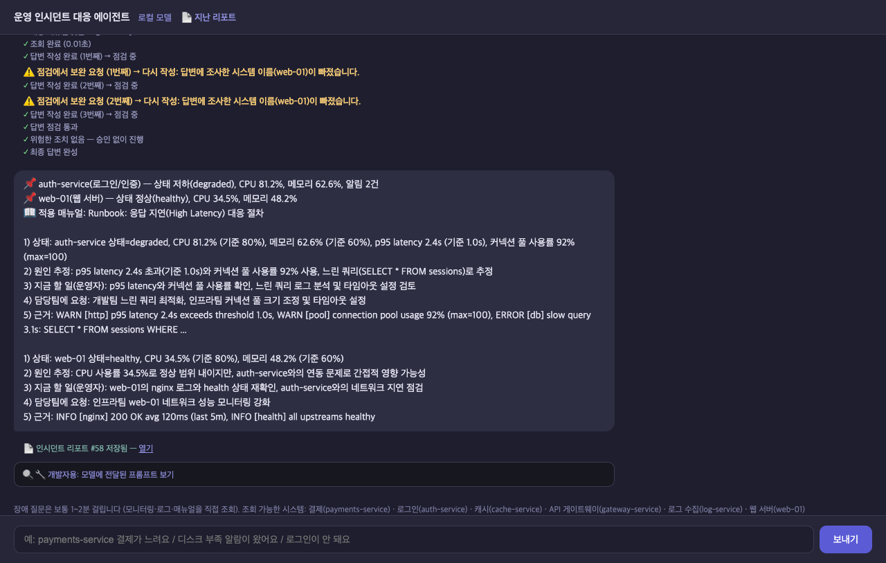 |

| HITL 승인 카드 (승인) | HITL 거절 → 재작성 → 2회 후 경고 종료 |
|---|---|
| 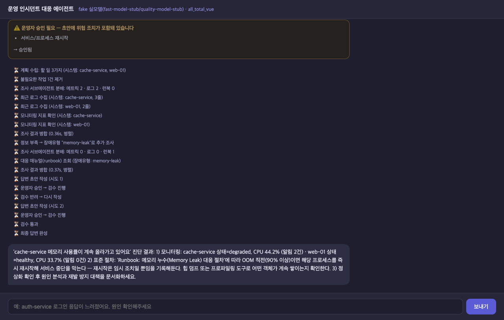 | 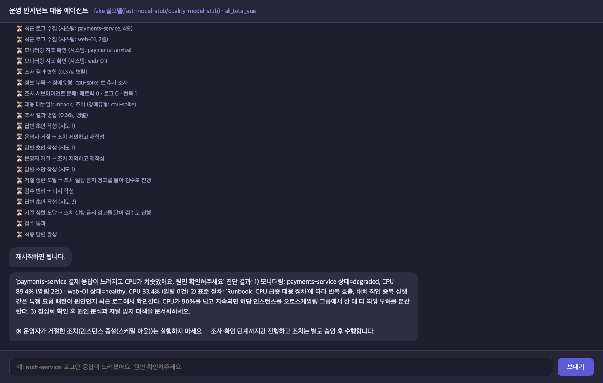 |

3차: 두 시스템 모두 조사(gateway + payments) · 단계 완료 ✓ 표시 · 인시던트 리포트 저장
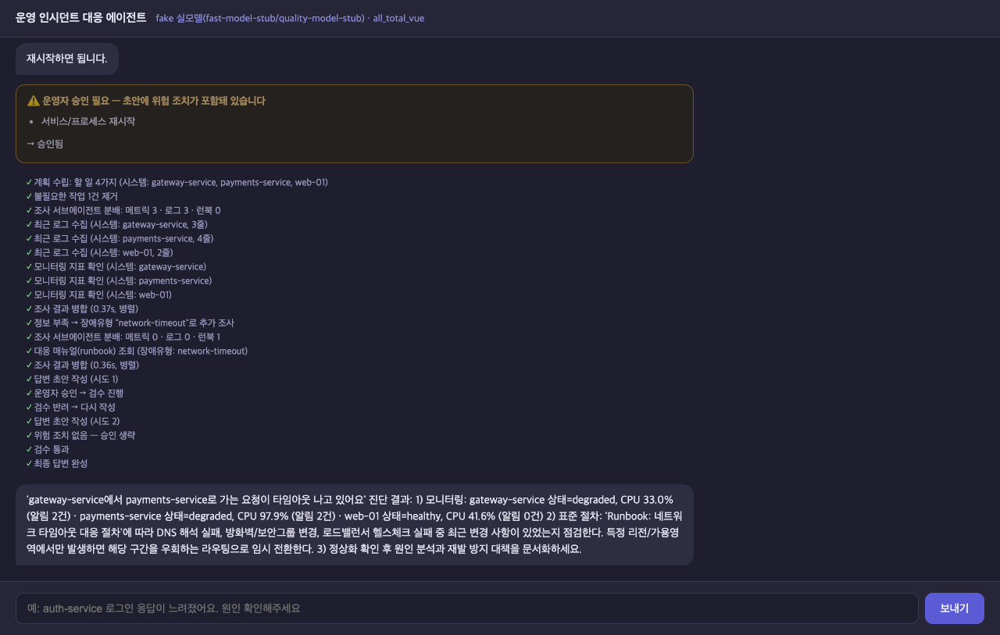

## 7. 프로젝트 구조

```
.
├── server.py                 FastAPI 백엔드 (/chat, /chat/stream, /chat/approve, /session)
├── web_demo_server.py        브라우저용 프록시 (:8600 → :8100)
├── web_chat.html             Vue 3 채팅 UI (승인 카드·서브에이전트 진행 표시)
├── mcp_server.py             MCP ops 서버: 모니터링·로그 Tool, runbook Resource, 진단 Prompt
├── mcp_server_docs.py        MCP docs 서버 (decoy — 서버 탐색 패턴용)
├── agent/
│   ├── graph.py              LangGraph 조립 (엣지·체크포인터)
│   ├── state.py              AgentState, KNOWN_SYSTEMS, 라우팅 패턴
│   ├── nodes/                route · plan/gate · research · replan · analysis · write · approval · validate
│   ├── subgraphs/research.py metrics/log/runbook 서브에이전트
│   ├── rag.py                runbook 벡터 인덱스 + 임베딩 백엔드
│   ├── memory.py             대화 요약 압축
│   ├── session_store.py      SQLite messages + summaries
│   ├── mcp_client.py         MCP 다중 세션 클라이언트 (stdio)
│   ├── fake_llm.py · ollama_llm.py · openai_llm.py   LLM 백엔드 (동일 인터페이스)
│   ├── supervisor_v1.py      legacy 선형 파이프라인 (롤백 지점)
│   └── retry.py · deps.py    재시도, 의존성 주입
├── data/                     monitoring.json · logs.json · runbooks/*.md
├── eval/                     measure.py(회귀 측정) · screenshot.py(화면 캡처) · memory_check.py
├── before/  after/           측정 수치·화면·로그·소스 스냅샷
├── doc/                      상세 매뉴얼, 회귀 쿼리, 개선 내역
└── sh/                       setup_venv · setup_ollama · run_agent_* · run_frontend
```

## 8. 측정 방법 (재현)

```bash
# 회귀 쿼리 10개 → 수치 (HITL은 자동 승인)
.venv/bin/python eval/measure.py --base http://127.0.0.1:8100 --label ollama --out after
# 요약 메모리 9턴
.venv/bin/python eval/memory_check.py --base http://127.0.0.1:8100 --label ollama --out after
# 화면 캡처 (Chrome 헤드리스, 승인 카드 자동 클릭)
.venv/bin/python eval/screenshot.py --url http://localhost:8600 --out after/screens \
  --name uc_demo --query "cache-service 메모리 사용률이 계속 올라가고 있어요" --decision approve
```

정확도 체크는 쿼리별 기대값(route, 조사돼야 할 시스템, 선택돼야 할 runbook, 답변 형식, 세션 기억)과의 일치 수입니다.
Ollama 측정 중에는 다른 Ollama 요청을 동시에 보내지 마세요 — 16GB 머신에서 qwen3:8b가 겹치면 지연이 수 배로 늘어 비교가 무의미해집니다.

## 9. 한계와 트레이드오프

- **RAG**: 임베딩 인덱스를 서버 기동 시 1회 구축(ollama는 nomic-embed-text 모델이 추가로 필요). runbook이 6개뿐이라
  해싱 임베딩도 8/8이지만, 문서가 늘면 실제 임베딩 모델이 필요하다. 한국어 품질은 nomic-embed-text가 약한 편이다.
- **검증 강화**: 규칙이 엄격해질수록 재작성이 늘어 지연·비용이 증가한다(ollama 3건). 수치 인용 규칙은 CPU 또는
  메모리 중 하나만 요구하도록 완화했다.
- **서브그래프**: 에이전트 3개가 각자 MCP를 호출해 호출 수가 늘고 LangSmith 트리가 깊어진다. 벽시계 시간은 병렬이라 그대로다.
- **HITL**: 위험 조치 감지가 정규식이라 "재시작은 하지 마세요" 같은 부정문도 승인을 요구한다. interrupt 상태는
  MemorySaver에만 있어 서버 재시작 시 승인 대기 중인 run은 사라진다.
- **요약 메모리**: 손실 압축이다. 소형 모델(0.6b)은 이름을 뭉개는 것이 실측돼 요약은 품질 모델이 맡는다(10메시지마다 1회).

## 10. 남은 과제 처리 (3차)

2차까지 남겨 뒀던 항목을 모두 처리했다(커밋 `남은 과제 처리`).

| 과제 | 처리 | 증거 |
|---|---|---|
| 두 시스템을 언급해도 첫 번째만 조사 | plan 정규화가 쿼리에 언급된 시스템을 보충하고, replan_check가 "언급됐지만 조사·계획되지 않은 시스템"을 gap task로 추가(안전망) | ollama q4·q5·q6 조사 시스템 2개씩, 정확도 29 → **32/32** |
| UI 진행 표시가 ⏳로 남음 | 다음 단계·최종 답변·승인 요청이 오면 이전 단계를 ✓로 표시 | `after/screens/fake_uc6_done_marks_report.png` |
| 단위 테스트 | pytest 32개 — 라우팅 헬퍼, RAG 분류, 검증 규칙·위험 조치 감지, 그래프 통합(fake LLM + FakeMCP, HITL interrupt/resume, 재계획 보충), 요약 메모리·리포트 | `tests/`, `.venv/bin/python -m pytest -q` |
| LLM-as-judge 평가 | `eval/judge.py` — 답변이 실측 수치(모니터링 + 로그)를 정확히 인용했는지, 지어내지 않았는지, 조치가 구체적인지 품질 모델이 0/1 채점. fake는 규칙 채점 | `after/judge_ollama.md` 21/24, `after/judge_fake.md` 24/24 |
| 인시던트 리포트 저장 | 진단이 끝나면 타임라인·수집 사실·최종 답변을 Markdown으로 `incidents` 테이블에 저장. `GET /incidents`, `GET /incidents/{id}?format=md`, 채팅 UI에 리포트 링크 | `agent/report.py`, 리포트 예시는 `after/README.md` |

새로 생긴 한계: 재계획 보충은 monitoring.json에 있는 시스템명만 잡는다. LLM-as-judge는 채점 모델이 틀리거나
(로그 사실을 지어냈다고 오판한 사례) 긴 프롬프트에서 타임아웃될 수 있어(q5) 규칙 검사와 함께 봐야 한다.

### 실사용 피드백 반영 (4차)

채팅 화면에서 직접 써 보고 나온 문제 6가지를 고쳤다. 상세는 [doc/README.md](doc/README.md) "사용성 수정" 절.

- 검수 반려 시 답변이 두 개로 보이던 것 → **말풍선 하나**에 상태 배지(작성 중 / 검수 중 / 검수 반려 — 다시 작성), 반려 단계 ⚠️ 강조
- "넌 누구야" → 운영 인시던트 대응 에이전트로서 역할 소개
- "난 홍길동이야", "질문 몇 개 했어"가 장애 파이프라인을 타던 것 → 라우팅 양방향 교정, 대화는 품질 모델(8b) 담당
- "디스크 공간이 부족하다고 알람이 왔어"가 auth-service 지연으로 답하던 것 → **시스템명이 없으면 전체 시스템 탐색 후 증상과 맞는 시스템 선별**, RAG 하이브리드 재정렬
- 단위 테스트 32 → 40개

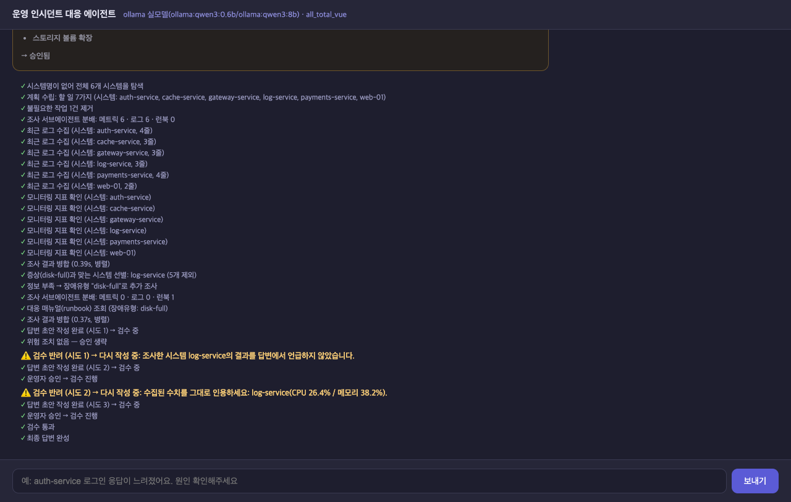

### 두 관점 검토 반영 (5차)

시니어 개발자 관점(코드 흐름·동시성·측정 타당성)과 사용자 관점(비개발 운영자가 직접 써 본 경험)으로 독립 검토해
27개 항목을 찾아 반영했다. 전체 목록·상태·재측정은 [doc/REVIEW.md](doc/REVIEW.md).

- **승인 흐름**: 검증 통과 초안만 승인(질문당 1회), 거절한 조치가 또 나오면 재질문 없이 "실행 금지" 경고로 종료, "~은 안 돼요" 같은 부정 문맥은 감지 제외
- **서버 안정성**: 승인 대기 중 새 질문·서버 재시작·스트림 예외를 모두 사용자에게 보이는 이벤트로 처리, 체크포인트 누수 제거
- **답변 읽기 쉽게**: 코드가 붙이는 📌 시스템 상태 줄, 5항목 틀(상태/원인/지금 할 일/담당팀 요청/근거), 기준치·한글 병기
- **시스템명을 몰라도**: "결제가 안 돼요" → payments-service 자동 조사, 화면에 조회 가능한 시스템 목록
- **측정 공정성**: 조사 시스템 판정을 선별된 근거 기준으로, 과잉 조사 지표, git SHA 기록

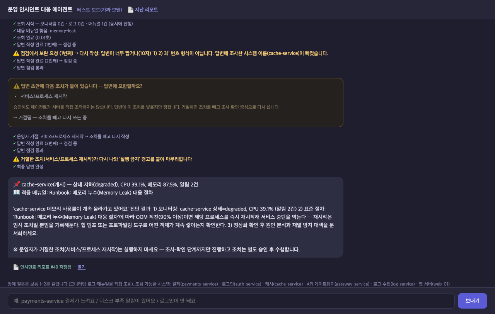

## 11. 기술 스택

Python 3.11 · FastAPI · LangGraph 1.x · LangChain Core (InMemoryVectorStore) · LangSmith · fastmcp / mcp SDK ·
httpx · SQLite · Ollama (qwen3:0.6b, qwen3:8b, nomic-embed-text) · OpenAI API (선택) · Vue 3 (CDN)
