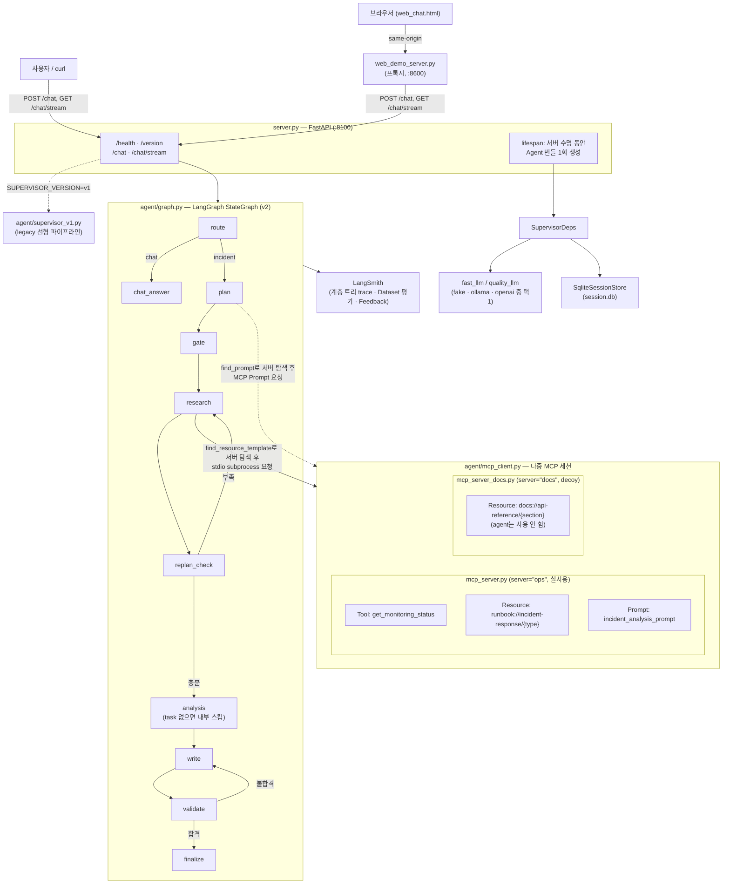
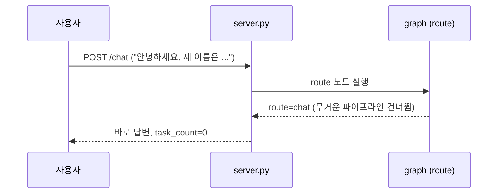
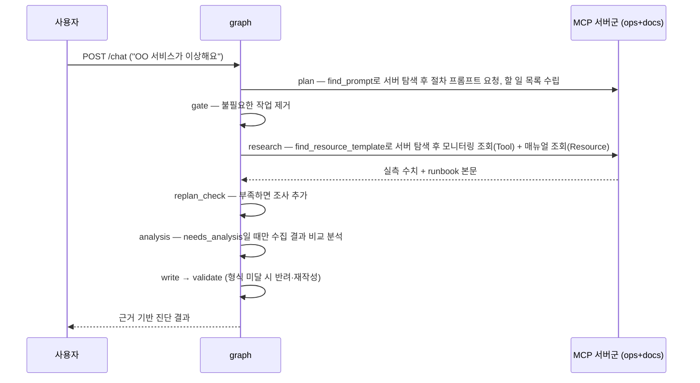
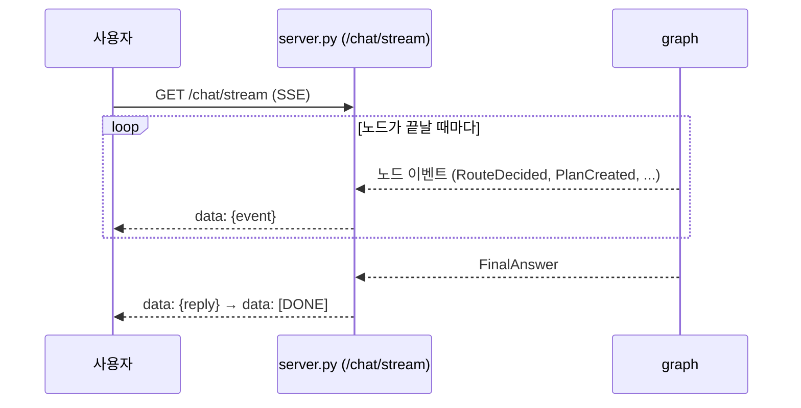
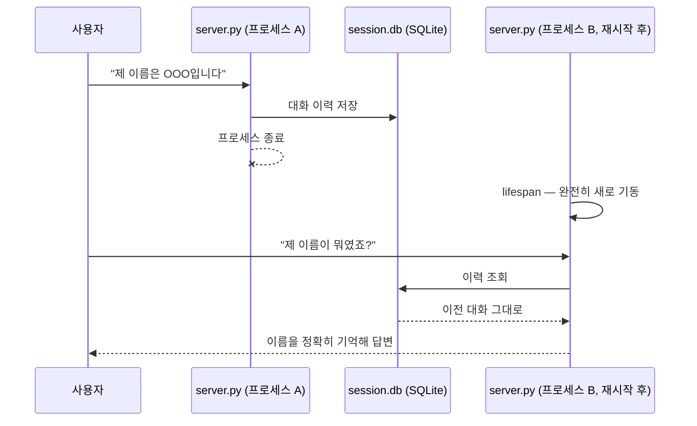
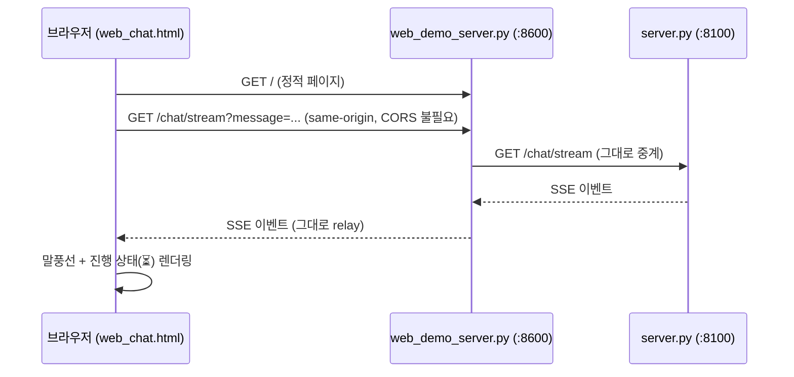
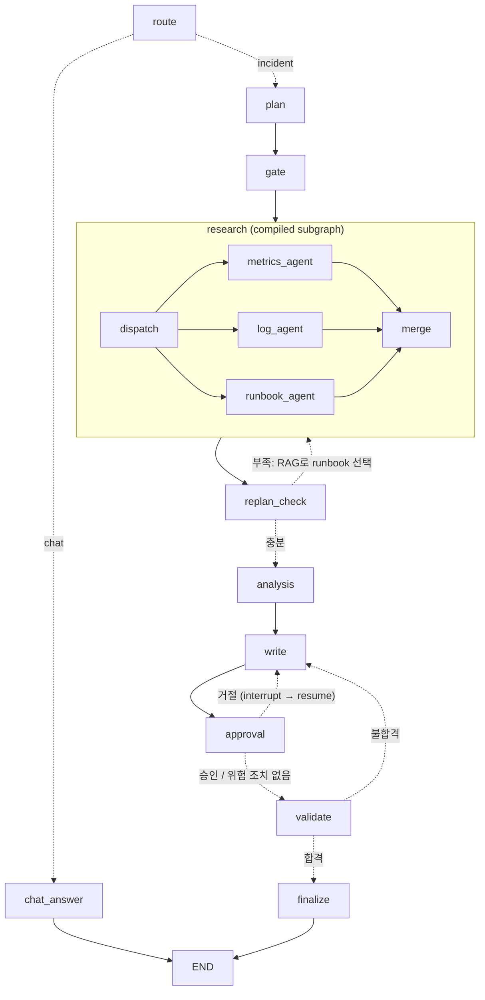

# all_total_vue — 운영 인시던트 대응 에이전트 (Vue 프론트엔드 버전)

`all_total`과 백엔드(server.py, agent/, mcp_server.py 등)는 완전히 동일하고, 브라우저
채팅 화면(`web_chat.html`)만 바닐라 JS 대신 **Vue 3**(CDN 글로벌 빌드, 별도 빌드 단계
없음)로 재작성한 버전이다. 나머지 설명은 원본 `all_total`과 같다.

Wave 1~15가 각각 증명한 패턴(싱글턴·MCP·SSE·라우팅·게이트·재계획·검증·재시도·병렬·비용분리·
세션·주입·버전 토글·가드)을 전부 조립한 **실제 동작하는 에이전트 서비스**다. LLM 자리는
`fake`(결정론)/`ollama`(로컬 실모델)/`openai`(실제 API) 세 백엔드 중 아무거나 꽂을 수 있고,
요청 한 건이 처리되는 전 과정은 LangSmith에 계층 트리로 기록·평가·피드백된다.

## 주요 실행 방법

**맨 처음 한 번만**: 이 폴더를 처음 받았다면(학생 배포 등) `.venv`부터 만든다.

```bash
bash sh/setup_venv.sh
```

| 방법 | 명령 | 비용 | 용도 |
|---|---|---|---|
| Python 가상환경 준비 | `bash sh/setup_venv.sh` | 없음 | `.venv` 생성 + `requirements.txt` 설치(최초 1회, 이미 있으면 설치만 재확인) |
| 로컬 Ollama 환경 준비 | `bash sh/setup_ollama.sh` | 없음(로컬 추론) | 모델(`qwen3:0.6b`/`8b`)이 이미 있으면 재사용, 없으면 새로 pull — `OLLAMA_FORCE_REFRESH=1`을 주면 지우고 재구성 |
| 에이전트만 기동 (로컬) | `bash sh/run_agent_ollma.sh` | 없음 | 서버만 띄워두고 직접 curl/웹으로 테스트 |
| 에이전트만 기동 (OpenAI) | `bash sh/run_agent_openai.sh` | **과금** | 위와 동일하되 실제 API 사용 (y/N 확인) |
| 브라우저 채팅 화면 | `bash sh/run_frontend.sh` (서버 기동 후) | 백엔드에 따름 | `http://localhost:8600`에서 실제 채팅 UI로 사용 |

`run_agent_*.sh`/`run_frontend.sh`는 `.venv`가 이미 있다는 가정 하에 PATH에
꽂아 쓰기만 한다(`.venv`가 없으면 시스템 `python3`로 조용히 떨어져 패키지
누락 오류가 날 수 있다) — `setup_venv.sh`를 먼저 돌려야 하는 이유다.

모든 스크립트는 `.env`가 없으면 `cp .env.example .env` 후 본인 API 키를 채우라는 안내를
출력하고 종료하며(외부 경로에 의존하지 않음 — 이 폴더만 떼어가도 그대로 동작),
LangSmith 프로젝트를 백엔드별로 분리해 기록한다(`capstone-all-total[-ollama|-openai]`).

> 더 쉬운 설명과 실제 캡처 화면이 필요하면 [manual_ollma.md](manual_ollma.md)(로컬
> 실모델) · [manual_openai.md](manual_openai.md)(OpenAI API)를 참고.

## 아키텍처 구성도



- **싱글턴**: `server.py`의 `lifespan`에서 `SupervisorDeps`(LLM·세션·MCP 연결)를 정확히
  1회 생성해 `app.state`로 공유한다 — 요청마다 재생성하지 않는다.
- **백엔드 교체**: `LLM_BACKEND` 환경변수 하나로 `fake_llm.py`/`ollama_llm.py`/
  `openai_llm.py`가 바뀌어 꽂히고, 그래프·MCP·세션 코드는 전혀 바뀌지 않는다.
- **버전 토글**: `SUPERVISOR_VERSION=v1`이면 라우팅·게이트·재계획·검증이 없는 legacy
  선형 파이프라인(`supervisor_v1.py`)으로, 재배포 없이 환경변수만으로 전환된다.
- **MCP는 별도 프로세스**: `mcp_server.py`(ops)가 stdio subprocess로 떠서 서버 수명 동안
  재사용되며, 모니터링 조회(Tool)·대응 매뉴얼(Resource)·진단 절차(Prompt) 세 가지
  capability를 모두 실사용한다.
- **MCP 멀티 서버 탐색**: `mcp_client.py`는 `ops`(mcp_server.py, 실사용)·`docs`
  (mcp_server_docs.py, 내부 API 문서 Resource만 제공하는 decoy) 두 서버에 동시
  연결한다. `plan`/`research` 노드는 어느 서버가 필요한 prompt/resource를 들고
  있는지 코드에 하드코딩하지 않고, `find_prompt()`/`find_resource_template()`로
  연결된 서버들을 먼저 조회한 뒤에야 그 서버로 요청을 보낸다.
- **분석 단계 분리**: `replan_check`가 조사 결과가 충분하다고 판단하면 항상
  `analysis` 노드로 넘어가지만, gate가 살려둔 `agent=="analysis"` task가 없으면
  `analysis_node`가 내부적으로 스킵하고 바로 `write`로 넘어간다 — `needs_analysis`가
  실제로 유효한 경우에만 수집된 모니터링 결과들을 비교 분석한다.

## 주요 유스케이스별 고수준 시퀀스 다이어그램

### 1. 가벼운 대화



### 2. 장애 진단 요청



### 3. 실시간 진행 상황 스트리밍



### 4. 서버 재시작 후 대화 기억



### 5. 웹 채팅 화면 사용



## 소스 디렉토리 구조

```
all_total_vue/
├── server.py              # FastAPI 진입점 — lifespan 싱글턴, /health·/version·/chat·/chat/stream
├── mcp_server.py           # fastmcp 서버("ops") — Tool/Resource/Prompt (실사용, stdio subprocess)
├── mcp_server_docs.py       # fastmcp 서버("docs") — API 문서 Resource만 제공하는 decoy (멀티 서버 탐색 데모용)
├── web_chat.html            # 브라우저 채팅 화면 (정적 1파일)
├── web_demo_server.py       # web_chat.html 서빙 + /chat·/chat/stream·/health 프록시(:8600)
├── requirements.txt
├── .env.example
│
├── agent/
│   ├── deps.py              # SupervisorDeps 의존성 주입
│   ├── graph.py              # v2 LangGraph StateGraph (route/plan/gate/research/replan_check/analysis/write/validate/finalize)
│   ├── supervisor_v1.py      # legacy 선형 파이프라인 (버전 토글 대상)
│   ├── fake_llm.py           # LLM_BACKEND=fake — 결정론적 fast/quality 모델 (route/plan/analyze/chat/write)
│   ├── ollama_llm.py         # LLM_BACKEND=ollama — 로컬 실모델 백엔드
│   ├── openai_llm.py         # LLM_BACKEND=openai — 실제 OpenAI API 백엔드
│   ├── mcp_client.py          # MCP 멀티 서버(ops+docs) stdio 클라이언트 — find_resource_template/find_prompt로 서버 탐색 + 의도적 flaky 1회(재시도 데모)
│   ├── retry.py              # Transient 전용 backoff 재시도
│   └── session_store.py       # SQLite 세션 저장소
│
├── data/
│   ├── monitoring.json        # MCP Tool이 조회하는 모니터링 데이터
│   └── runbooks/               # MCP Resource가 조회하는 대응 매뉴얼 6종
│       ├── db-down.md
│       ├── cpu-spike.md
│       ├── disk-full.md
│       ├── high-latency.md
│       ├── memory-leak.md
│       └── network-timeout.md
│
├── sh/                        # 실행 스크립트 모음 (학생 배포용 — 내부 회귀 테스트 스크립트는 제외)
│   ├── setup_venv.sh            # .venv 생성 + requirements.txt 설치 (맨 처음 1회)
│   ├── setup_ollama.sh          # 로컬 Ollama 모델 준비 — 있으면 재사용, 없으면 pull (리셋은 OLLAMA_FORCE_REFRESH=1)
│   ├── run_agent_ollma.sh       # 에이전트만 기동 — 로컬 실모델
│   ├── run_agent_openai.sh      # 에이전트만 기동 — OpenAI API (과금)
│   ├── run_frontend.sh          # 브라우저 채팅 화면(web_demo_server.py) 기동
│   └── make_student_zip.sh      # .env 제외 + .env.example 포함한 학생 배포용 zip 생성
│
├── doc/                       # 문서
│   ├── README.md                # 이 문서
│   ├── manual_ollma.md          # 사용자 가이드 — 로컬 실모델 기준
│   ├── manual_openai.md         # 사용자 가이드 — OpenAI API 기준
│   ├── regression_test_queries.md  # 시스템명 하드코딩 수정 검증용 회귀 테스트 쿼리 목록
│   ├── image_usecase/           # manual_ollma.md 캡처 이미지
│   └── image_usecase_openai/    # manual_openai.md 캡처 이미지
```

---

## Mini-project 개선 내역 (1차 — 기본 기능 개선)

Before 기준선은 [`before/README.md`](../before/README.md), After 측정은 `after/`에 같은 스크립트
(`eval/measure.py`)로 기록했다.

| # | 영역 | 무엇을 바꿨나 | 파일 |
|---|---|---|---|
| 1 | 모듈화 | 338줄짜리 `graph.py`를 노드별 모듈로 분리. `graph.py`는 조립(엣지)만 담당 | `agent/nodes/*.py`, `agent/state.py` |
| 2 | RAG | 키워드 9줄 규칙 + db-down 폴백으로 고르던 incident_type을 runbook 벡터 인덱스(InMemoryVectorStore) 의미 검색으로 교체. 임베딩은 백엔드별(fake=해싱, ollama=nomic-embed-text, openai=text-embedding-3-small) | `agent/rag.py`, `agent/nodes/replan.py`, `data/runbooks/*.md`(증상 섹션 추가) |
| 3 | 라우팅 | "느려요/타임아웃/메모리/디스크" 등 확장 패턴 + 알려진 시스템명 언급 시 incident로 코드 교정 (fake 회귀 10건 중 9건 오분류 → 0건) | `agent/state.py`, `agent/nodes/route.py` |
| 4 | 검증 강화 | 길이·번호 검사에 더해 ① 조사한 시스템 전부 언급 ② CPU 수치 인용 ③ 조사·질문에 없는 시스템명 금지. 반려 사유를 write에 피드백 | `agent/nodes/validate.py` |
| 5 | 안정성 | Ollama/OpenAI 호출을 동기 `httpx.post` → 비동기로 바꿔 한 요청이 서버 전체를 막던 문제 해결. 소형 모델 타임아웃(기본 90s) 시 코드 레벨 계획으로 복구 (billing-service 500 오류 해결) | `agent/ollama_llm.py`, `agent/openai_llm.py` |
| 6 | fake 계획 | 목록 밖 시스템(billing-service)을 조사 대상으로 삼던 정규식을 KNOWN_SYSTEMS 클램프로 교체, 분석 요청 시 needs_analysis=True | `agent/fake_llm.py` |

측정(회귀 쿼리 10개, 정확도 체크 통과 수): fake 7/32 → 32/32.

## Mini-project 추가 기능 (2차 — 기능 추가)

| # | 영역 | 무엇을 추가했나 | 파일 |
|---|---|---|---|
| 1 | 멀티 에이전트 | 단일 `research_node`를 **compiled subgraph**로 교체. `dispatch → (metrics_agent ∥ log_agent ∥ runbook_agent) → merge`. 세 서브에이전트는 같은 superstep에서 동시에 돌고 `Annotated[list, add]` 채널에 결과만 추가하며, merge가 task 상태·재시도·소요시간을 한 번에 정리한다(supervisor-of-supervisors). log_agent용으로 MCP Tool `get_recent_logs`와 `data/logs.json`을 추가 | `agent/subgraphs/research.py`, `mcp_server.py`, `data/logs.json` |
| 2 | Human-in-the-loop | `write → approval → validate`. 초안에 재시작·롤백·failover·스케일 아웃·LB 제외·볼륨 확장·삭제 같은 조치가 있으면 `interrupt()`로 멈추고 `ApprovalRequired`를 보낸다. 승인 → 검수 진행, 거절 → 거절 사유를 피드백으로 write에 되돌려 재작성, 2회 거절 후에도 같은 조치가 나오면 "실행 금지" 경고를 달아 검수로 진행(무한 루프 방지). 체크포인터는 MemorySaver, run마다 고유 thread id | `agent/nodes/approval.py`, `agent/graph.py`, `server.py`(`/chat/approve`, `/chat/approve/stream`), `web_chat.html`(승인/거절 카드) |
| 3 | 대화 요약 메모리 | 요약되지 않은 메시지가 10개를 넘으면 최근 4개만 원문으로 남기고 나머지를 `fast_llm.summarize()`로 요약해 `summaries` 테이블에 누적 저장. `session_store.load()`는 `[요약(system)] + 최근 원문`만 돌려준다. `/session/{thread_id}`로 원문 수·요약된 수·LLM에 실리는 이력 크기를 확인 | `agent/memory.py`, `agent/session_store.py`, `agent/*_llm.py`(`summarize`), `eval/memory_check.py` |

### 그래프 (2차 이후)



### 한계·트레이드오프

- **서브그래프**: 노드 수가 늘어 LangSmith 트리가 깊어지고, 에이전트 3개가 각각 MCP를 호출해 호출 수가 늘었다(로그 조회는 모니터링 대상마다 1회 추가). 병렬이라 벽시계 시간은 늘지 않았다(fake 기준 0.36s 유지).
- **HITL**: 위험 조치 감지는 정규식이라 "재시작은 하지 마세요" 같은 부정문도 승인을 요구한다(오탐). interrupt 상태는 MemorySaver에만 있어 서버 재시작 시 승인 대기 중인 run은 사라진다. 승인 대기 중 같은 thread로 새 질문을 보내면 이전 승인 요청은 폐기된다.
- **요약 메모리**: 요약은 손실 압축이다 — fake 백엔드는 추출 요약(이름·질문 앞부분)만 남기고, 실모델 요약은 비결정적이라 "이름을 정확히 보존하라"는 지시에 의존한다. 요약 LLM 호출 비용이 10메시지마다 1회 추가된다.
