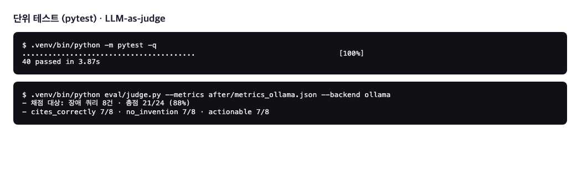
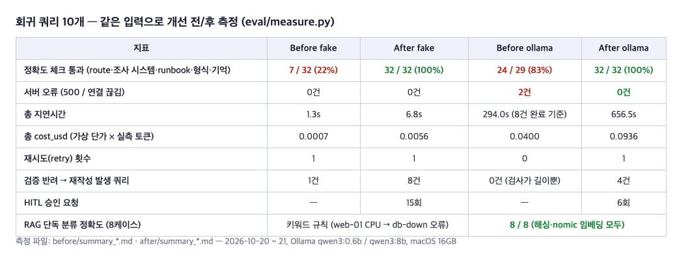
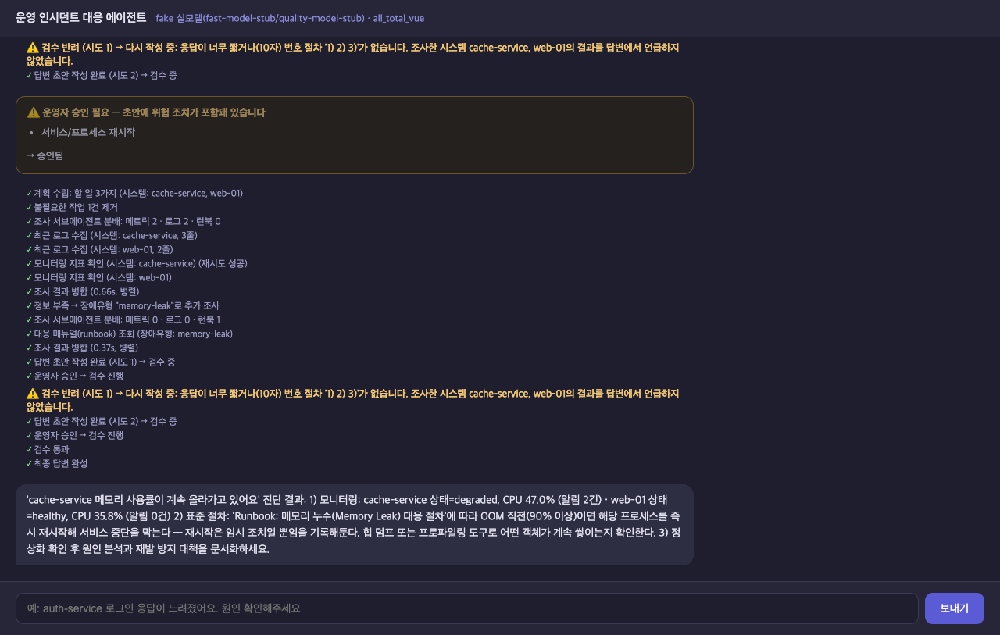

# AI 서비스 개발 Mini-project 결과 보고서

> **번호: [UID 기재]  ·  성함: [이름 기재]**  ·  반: [반 기재]
> 선택 과제: **1번 — Base AI Agent 기능 개선/추가**
> 저장소: https://github.com/boboinhaco/AI-Agent-Mini-Project

---

## 1. 진행 사항 소개

### 1-1. 이 에이전트는 무엇을 하나

"운영 인시던트 대응 에이전트"는 서버 운영팀이 쓰는 **AI 당직 담당자**입니다. 운영자가 채팅창에
"결제 서비스가 느려요" 같은 말을 하면, 에이전트가 ① 어떤 서버가 문제인지 찾고 ② 그 서버의
모니터링 수치와 최근 로그를 직접 조회하고 ③ 회사의 대응 매뉴얼(runbook)에서 맞는 절차를 찾아
④ "지금 상태는 이렇고, 이렇게 조치하세요"라는 보고를 돌려줍니다.

### 1-2. 과제 1번으로 한 일 (추가/수정 task)

주어진 Base 코드를 그대로 쓰면서 아래 과제들을 진행했습니다. 기준은 "같은 질문을 넣었을 때 개선 전보다
더 정확하고, 더 안전하고, 덜 죽는가"였습니다.

| 구분 | Task | 한 줄 설명 |
|---|---|---|
| 수정 | ① 모듈화 | 한 파일(338줄)에 뭉쳐 있던 그래프 노드 10개를 역할별 파일로 분리 |
| 수정 | ② RAG 기반 장애 유형 분류 | 키워드 9줄 규칙 대신 runbook을 벡터로 검색해 맞는 매뉴얼을 고름 |
| 수정 | ③ 라우팅 판단 개선 | "느려요·타임아웃·디스크" 같은 표현을 장애로 인식, 잡담은 잡담으로 |
| 수정 | ④ 검증 노드 강화 | 답변이 조사한 수치를 실제로 인용했는지, 없는 서버를 지어내지 않았는지 코드로 검사 |
| 추가 | ⑤ Research 서브그래프 (멀티 에이전트) | 조사 담당을 메트릭·로그·런북 전문 에이전트 3개로 나눠 동시에 실행 |
| 추가 | ⑥ Human-in-the-loop 승인 | 재시작·롤백 같은 위험 조치는 사람이 승인해야 진행 |
| 추가 | ⑦ 대화 요약 메모리 | 대화가 길어지면 과거를 요약해 저장, 토큰·속도 절약 |
| 추가 | ⑧ 단위 테스트 40개 · LLM-as-judge 평가 · 인시던트 리포트 저장 | 품질을 자동으로 확인하고 결과를 남김 |
| 수정 | ⑨ 실사용 피드백 반영 | 시스템명 없는 문의 처리, 답변 말풍선 하나로, 에이전트 정체성 답변 등 |

### 1-3. 진행 순서

1. **Before 기록**: 코드를 고치기 전에 같은 질문 10개를 돌려 수치·화면을 `before/`에 보관
2. **1차 기본 기능 개선** (①~④) → 커밋 `기본 기능 개선`
3. **2차 기능 추가** (⑤~⑦) → 커밋 `기능 추가`
4. **3차 남은 과제** (⑧) → 커밋 `남은 과제 처리`
5. **4차 실사용 피드백** (⑨) → 커밋 `사용성 수정`
6. 매 단계마다 같은 스크립트로 After를 재측정해 `after/`에 보관

---

## 2. 사용한 기술 요소

### 2-1. 기술 요소별 적용 내용

| 기술 요소 | 어디에, 어떻게 썼나 | 파일 |
|---|---|---|
| **Multi-Agent** | 조사 단계를 `dispatch → (metrics_agent ∥ log_agent ∥ runbook_agent) → merge` 서브그래프로 분리. 세 에이전트가 같은 순간에 동시에 돌고 merge가 결과를 합침. 메인 그래프에는 이 서브그래프가 노드 하나로 꽂힘 | `agent/subgraphs/research.py` |
| **MCP** | 모니터링 조회·로그 조회(Tool), 대응 매뉴얼(Resource), 진단 절차(Prompt)를 MCP 서버가 제공. 서버 2개(ops·docs)에 동시에 연결해 "어느 서버가 그걸 갖고 있나"를 먼저 찾은 뒤 요청. 이번에 `get_recent_logs` Tool을 추가 | `mcp_server.py`, `agent/mcp_client.py` |
| **RAG** | runbook 6개를 벡터 DB(InMemoryVectorStore)에 넣고, "사용자 질문 + 수집된 알림"으로 가장 가까운 runbook을 검색. 임베딩은 백엔드별(fake=해싱, ollama=nomic-embed-text, openai=text-embedding-3-small). 한국어가 약한 임베딩을 보완하려고 증상 어휘 겹침 점수로 재정렬 | `agent/rag.py`, `agent/nodes/replan.py`, `data/runbooks/*.md` |
| **의존성 주입** | LLM·MCP·세션·RAG·대화 모델 등 모든 외부 의존성을 `SupervisorDeps` 하나에 담아 노드에 주입. 테스트에서는 가짜 MCP로 바꿔 끼움 | `agent/deps.py`, `tests/conftest.py` |
| **LangSmith** | 요청마다 노드·LLM·MCP 호출이 계층 트리로 기록. 서브그래프·RAG 검색(`run_type=retriever`)도 trace에 포함 | 모든 노드의 `@traceable` |
| **모듈화** | `graph.py`는 조립(엣지)만, 노드는 `agent/nodes/`에 파일별, 공용 상태는 `agent/state.py` | `agent/graph.py`, `agent/nodes/` |
| **단위 테스트** | pytest 40개 — 라우팅, RAG 분류, 검증 규칙, 그래프 통합(HITL 중단·재개 포함), 요약 메모리, 리포트 | `tests/` |
| **Human-in-the-loop** | LangGraph `interrupt()`로 그래프를 멈추고 `/chat/approve`로 재개. 거절하면 사유를 들고 재작성 | `agent/nodes/approval.py`, `server.py` |
| **메모리 관리** | 메시지 10개 초과 시 과거를 품질 모델이 요약해 SQLite에 저장, LLM에는 요약 + 최근 4개만 전달 | `agent/memory.py`, `agent/session_store.py` |
| **평가 (LLM-as-judge)** | 답변이 실측 수치를 정확히 인용했는지 등 3항목을 LLM이 채점 | `eval/judge.py` |

### 2-2. 아키텍처와 그래프

아키텍처 (위: 요청 경로, 가운데: LangGraph 파이프라인, 아래: MCP·RAG·데이터·LangSmith·LLM)


개선 전 그래프 → 개선 후 그래프


### 2-3. 구현 기능 화면 캡처

**멀티 에이전트 조사 + HITL 승인 카드** — 조사 서브에이전트 분배·로그 수집·병합 단계가 보이고, 초안에
"재시작" 조치가 있어 운영자 승인 카드가 뜸. 승인하면 검수로 진행.


**HITL 거절 → 재작성 → 2회 거절 후 경고 종료** — 거절 사유가 피드백으로 들어가 다시 작성되고, 계속 같은
조치가 나오면 "실행 금지" 경고를 달아 끝냄.


**시스템명 없는 문의 처리 + 단일 답변 말풍선 + 검수 상태 표시** — "디스크 공간이 부족하다고 알람이 왔어"에
전체 6개 시스템을 탐색한 뒤 증상(disk-full)과 맞는 log-service만 선별. 검수 반려 단계가 ⚠️로 강조됨.


**단계 완료 표시(✓) + 인시던트 리포트 저장** — 두 시스템(gateway·payments) 모두 조사.


### 2-4. 최종 실행 화면

실모델(Ollama qwen3:8b)로 "web-01 CPU 급증, auth-service 커넥션 풀도 같이 확인해줘"를 물었을 때.
RAG가 `cpu-spike` runbook을 고르고 서브에이전트 분배·병합을 거쳐 수치를 인용한 답변이 나옴.


단위 테스트와 LLM-as-judge 실행 결과



---

## 4. 선택 사항 — 같은 입력으로 개선 전/후 비교

### 4-1. 수치 비교 (회귀 쿼리 10개, `eval/measure.py`)



읽는 법:
- **정확도 체크**는 질문마다 "장애로 분류했나, 맞는 서버를 조사했나, 맞는 매뉴얼을 골랐나, 번호 절차로 답했나,
  이름을 기억했나"를 세어 맞은 개수입니다. fake 22% → 100%, ollama 83% → 100%.
- **서버 오류 2건 → 0건**: 개선 전에는 "billing-service 응답이 느려요"에서 소형 모델이 300초 무응답 → 서버가
  500 오류를 냈고, 그동안 서버 전체가 멈춰 다음 질문까지 끊겼습니다. 호출을 비동기로 바꾸고 타임아웃 시 코드가
  계획을 대신 세워 해결했습니다.
- **지연·비용은 늘었습니다** (ollama 294s → 656s). 이유는 ① 검증이 실제로 반려해 재작성이 일어나고(개선 전엔
  어떤 답도 1회 통과), ② 무응답 모델을 90초 기다렸다 복구하며, ③ 로그 조회와 전체 시스템 탐색이 추가됐기 때문입니다.
  정확도·안정성과 맞바꾼 비용입니다.

### 4-2. 같은 질문의 화면 비교

"web-01 CPU 급증, auth-service 커넥션 풀도 같이 확인해줘"

| Before | After |
|---|---|
| web-01만 조사, 매뉴얼은 엉뚱한 `db-down` | 서브에이전트 분배 → `cpu-spike` 매뉴얼, 수치 인용 |
|  |  |

"payments-service 결제 응답이 느려지고 CPU가 치솟았어요" (fake 백엔드)

| Before | After |
|---|---|
| 장애 문의를 잡담으로 오분류 → "안녕하세요! 무엇을 도와드릴까요?" | 장애 파이프라인 → 모니터링·매뉴얼 기반 답변 + 승인 카드 |
|  |  |

### 4-3. RAG 분류 정확도 (단독 테스트 8케이스)

| 방식 | 결과 | 예 |
|---|---|---|
| Before: 키워드 규칙 | web-01 CPU 급증(healthy, 알림 없음) → 키워드 못 찾아 기본값 `db-down` | 틀림 |
| After: 벡터 검색 + 어휘 재정렬 | 해싱 임베딩 8/8, nomic 임베딩 8/8 | `cpu-spike` |

### 4-4. 요약 메모리 (9턴 대화, `eval/memory_check.py`)

12번째 메시지에서 과거 8개를 요약해 LLM에 실리는 이력이 10개 → 5개 메시지로 줄었고, 9턴째 "제 이름이
뭐였죠?"에 두 백엔드 모두 "민수"를 회상. 실모델 요약: `사용자 이름: 민수 / 주요 사실: … / 진행 중인 요청: …`

---

## 5. 느낀 점과 이후 개선 포인트

### 느낀 점

- **모델을 믿지 말고 코드로 확인하라**는 원칙이 가장 크게 와닿았습니다. 소형 모델은 "난 홍길동이야"를 장애로
  분류하고, 두 서버를 말해도 하나만 계획하고, 디스크 문의에 CPU 매뉴얼을 골랐습니다. 매번 "모델 결과를 코드가
  한 번 더 확인하는 층"을 넣는 것으로 해결됐습니다.
- **측정부터 하고 고치니 설득이 쉬웠습니다.** Before를 먼저 기록해 두니 "무엇이 왜 좋아졌는지"를 숫자와 화면으로
  보일 수 있었고, 반대로 지연·비용이 늘어난 것도 숨기지 않고 트레이드오프로 설명할 수 있었습니다.
- **RAG는 데이터가 반입니다.** runbook 본문만 임베딩했을 때는 5/7이었고, 증상 섹션을 보강하자 8/8이 됐습니다.
  임베딩 모델이 한국어에 약하다는 것도 실측에서야 알았습니다.
- 실제로 써 보니 설계 때 못 본 문제(답변이 두 개로 보임, 자기소개를 못 함, 시스템명 없는 문의)가 나왔습니다.
  **사용자 화면에서 직접 써 보는 단계**가 꼭 필요합니다.

### 이후 반영하고 싶은 개선 포인트

1. 위험 조치 감지를 정규식에서 LLM 판단 + 조치 목록 화이트리스트로 바꿔 "재시작은 하지 마세요" 같은 부정문 오탐 제거
2. 승인 대기 상태를 MemorySaver(메모리) 대신 SQLite 체크포인터로 옮겨 서버 재시작에도 유지
3. LLM-as-judge가 긴 프롬프트에서 타임아웃되는 문제(q5) — 채점 입력을 요약하거나 모델을 분리
4. 실제 모니터링 시스템(Prometheus 등)과 연결하는 MCP Tool로 교체해 가짜 데이터를 실데이터로
5. 조치 Tool(`restart_service`, `scale_out`)을 추가해 승인 후 실제 실행까지 — 지금은 제안까지만

---

### 부록: 실행 방법과 저장소 구성

```bash
bash sh/setup_venv.sh && ollama pull nomic-embed-text
bash sh/run_agent_ollma.sh      # 백엔드 :8100
bash sh/run_frontend.sh         # http://localhost:8600
.venv/bin/python -m pytest -q   # 단위 테스트
```

| 경로 | 내용 |
|---|---|
| `README.md` | 프로젝트 소개·Before/After·구조 |
| `doc/README.md` | 상세 매뉴얼 + 1~4차 개선 내역 |
| `before/`, `after/` | 측정 수치·화면·로그·소스 스냅샷 |
| `doc/SCRIPT.md` | 발표 대본 |
